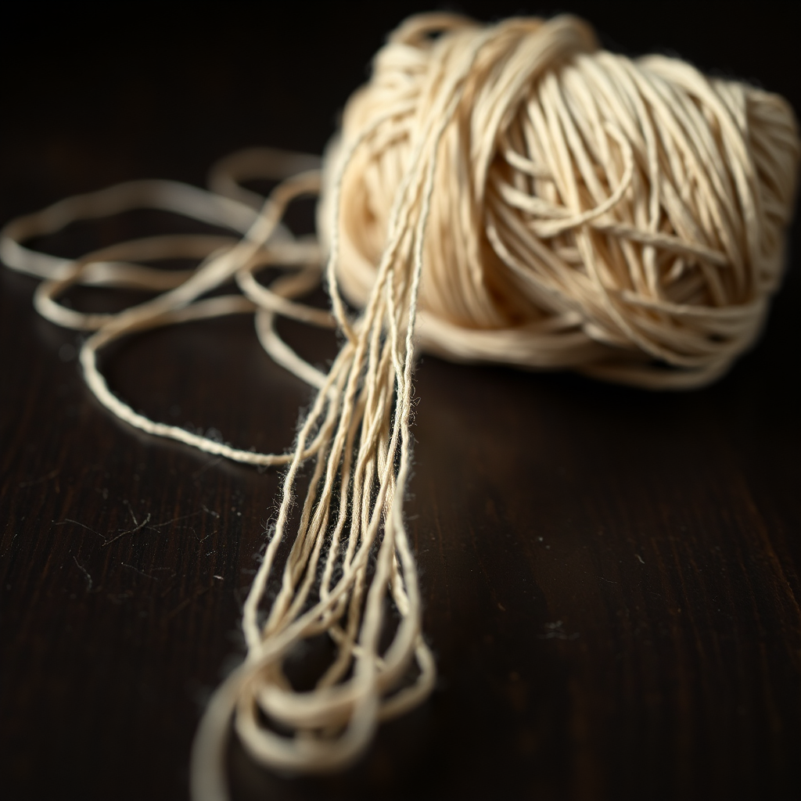
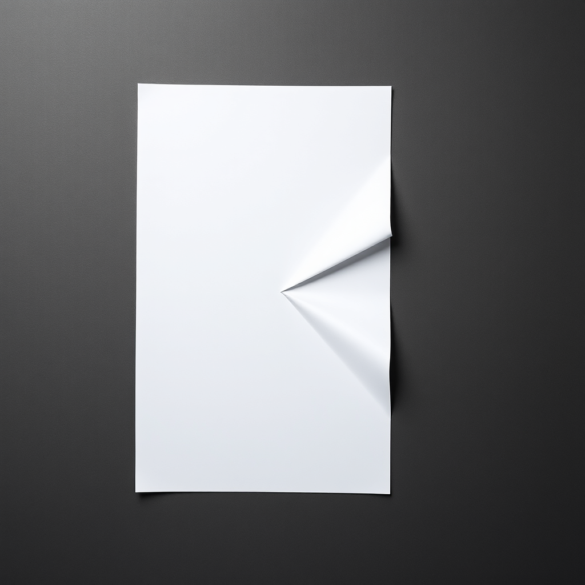

# PREVIEW — Publication "Idée"

Format : preview brute (image + texte), sans mise en page ni habillage. La mise en page définitive n'intervient qu'après cette étape. Cette preview sert uniquement à valider le contenu (photos, prompts, textes) avant la mise en ligne.

Thème : **Idée**
Nombre d'articles : 3
Outil de génération : ShowMe5WH (ComfyUI, en local sur le Mac mini)
Statut : preview prête — en attente de l'accord de l'auteur pour la mise en ligne (aucune publication publique sans validation explicite).

---

## Article 1 — Le fil qui se dégage

**Prompt (français) :** Photographie photoréaliste en studio, macro : une bobine de fil de lin écru posée sur une table en bois sombre, un unique fil se déroulant depuis un tas emmêlé et se tendant en une ligne parfaitement droite vers le bord du cadre. Éclairage latéral doux, fond noir profond, mise au point extrême sur la tension du fil, grain photographique fin, aucune présence humaine.

**Modèle de génération :** Flux.1 Schnell (mflux, 4-bit) via ShowMe5WH / ComfyUI

**Texte :**

Une pelote de fil de lin, encore entortillée sur elle-même, et pourtant un brin s'en échappe déjà, plus net que les autres, qui trouve son chemin vers le bord du cadre. Rien n'est démêlé — mais quelque chose a commencé à se dégager.

C'est souvent ainsi qu'une idée arrive : non pas comme un objet fini qu'on découvrirait tout formé, mais comme un fil qu'on remarque au milieu d'un enchevêtrement plus large de pensées, d'images, de bribes de conversations. On ne sait pas encore où il mène. On sait seulement qu'il se détache du reste, qu'il attire l'attention plus que les autres.

Le vrai travail commence après cette photo : tirer le fil, voir jusqu'où il va, accepter qu'il puisse casser ou revenir se perdre dans la pelote. L'idée, à ce stade, n'est encore qu'une promesse de forme — la tension d'un geste qui n'a pas fini de se dérouler.

---

## Article 2 — Le pli qui se soulève

**Prompt (français) :** Photographie photoréaliste en studio, vue de dessus : une feuille de papier blanc posée sur fond gris anthracite, sa moitié gauche parfaitement plate et lisse, sa moitié droite repliée en un pli diagonal net formant un triangle pointu qui se soulève du plan de la table, créant une ombre portée marquée. Lumière douce zénithale légèrement rasante pour souligner le relief du pli, texture du papier visible, composition centrée, aucune présence humaine.

**Modèle de génération :** Flux.1 Schnell (mflux, 4-bit) via ShowMe5WH / ComfyUI

**Texte :**

Une feuille blanche, presque entièrement plate — et sur un seul de ses bords, un pli net se soulève du plan, comme si le papier avait décidé, à cet endroit précis, de ne plus rester sage. Le reste de la feuille ignore encore ce qui se prépare.

Une idée procède rarement d'un bouleversement total. Le plus souvent, elle apparaît comme cette pointe unique qui se détache d'une surface par ailleurs inchangée : une remarque en marge d'une réunion, un détail qui ne collait pas tout à fait, une question posée un peu de travers. Tout le reste continue comme avant. Seul ce pli indique qu'une transformation est possible.

Ce qui frappe, dans cette image, c'est l'économie du geste : il n'a fallu qu'un mouvement pour faire naître une ombre, un relief, une direction nouvelle. L'idée n'a pas besoin de refaire toute la feuille — elle a seulement besoin d'un point où le plan cesse d'être plan.

*(Note : deuxième tentative de génération — la première ne produisait qu'un pli quasi invisible, non conforme au prompt.)*

---

## Article 3 — La couronne suspendue

**Prompt (français) :** Photographie photoréaliste en macro haute vitesse : une goutte d'encre noire figée en pleine diffusion à la surface d'une eau claire, formant une couronne symétrique de fines volutes suspendues, fond blanc pur. Éclairage en contre-jour révélant la transparence des volutes, netteté extrême sur l'instant de l'impact, aucune présence humaine.

**Modèle de génération :** Flux.1 Schnell (mflux, 4-bit) via ShowMe5WH / ComfyUI

**Texte :**

Une goutte d'encre vient de heurter l'eau. L'instant est figé juste avant que tout ne retombe : une couronne parfaite, symétrique, tenue en suspension par la seule vitesse de l'impact — et déjà une nouvelle goutte qui se détache au-dessus, prête à répéter le geste.

C'est l'image la plus fidèle qu'on puisse se faire du moment où une idée surgit : une diffusion brutale et brève, qui déploie en une fraction de seconde une forme d'une netteté inattendue, avant de se dissoudre dans l'eau environnante si personne ne la retient. La couronne ne durera pas. Ce qui compte, c'est qu'elle ait existé assez longtemps pour être vue.

Il y a aussi, dans cette photo, l'idée d'une répétition possible : la goutte suivante tombera à son tour, formera sa propre couronne, différente de la précédente. Une idée n'est jamais unique dans le temps — elle est un impact parmi d'autres, dont certains suffisent, une fois, à changer la surface de l'eau.
