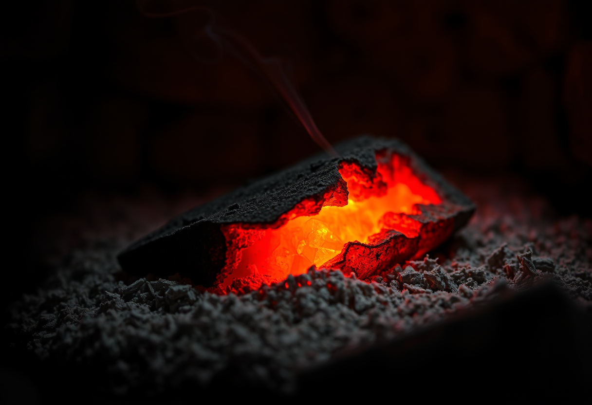
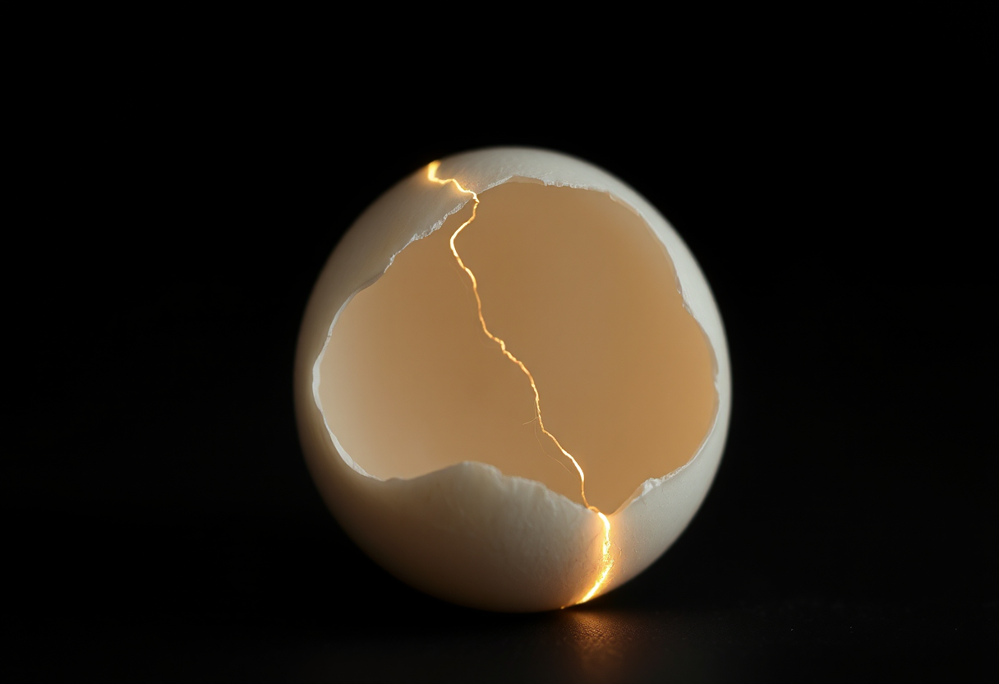
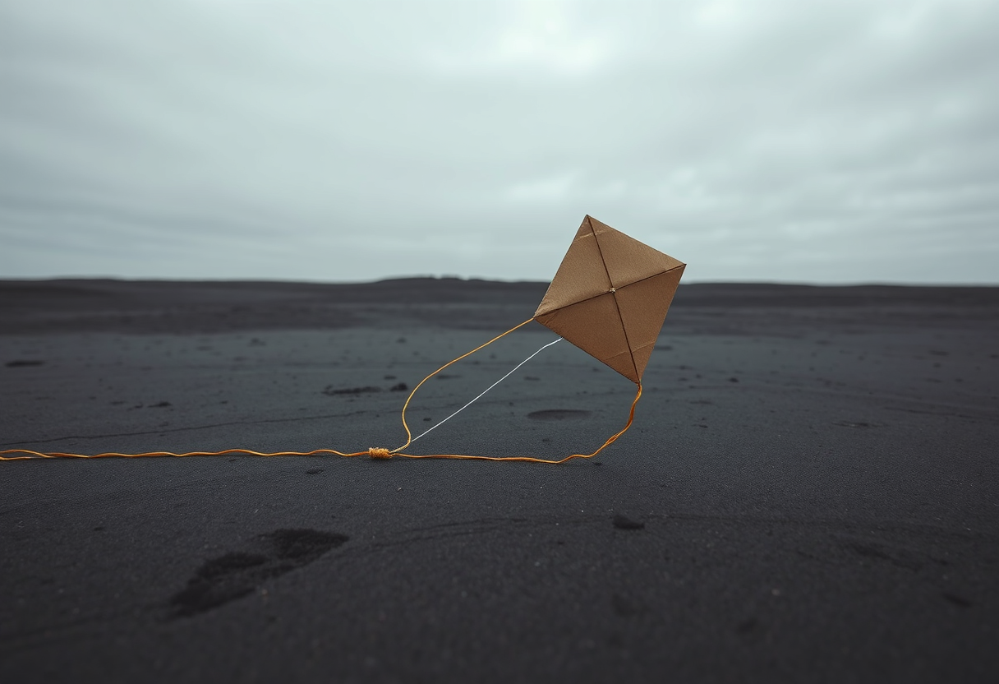

# PREVIEW — Publication "Espoir"

Format : preview brute (image + texte), sans mise en page ni habillage. La mise en page définitive n'intervient qu'après cette étape. Cette preview sert uniquement à valider le contenu (photos, prompts, textes) avant la mise en ligne.

Thème : **Espoir**
Nombre d'articles : 3
Outil de génération : ShowMe5WH (ComfyUI, en local sur le Mac mini)
Statut : preview prête — en attente de l'accord de l'auteur pour la mise en ligne (aucune publication publique sans validation explicite).

---

## Article 1 — La braise sous la cendre

**Prompt (français) :** Photographie photoréaliste en macro, plan très rapproché : un morceau de charbon de bois incandescent orange vif, à moitié recouvert d'un lit de cendres grises fines, dans l'obscurité presque totale d'un foyer éteint. Un mince filet de fumée s'élève au-dessus. Éclairage provenant uniquement de la lueur rouge du charbon lui-même, contraste extrême entre l'orange chaud et le noir profond, grain photographique fin, aucune flamme visible, aucune présence humaine.

**Modèle de génération :** Flux.1 Schnell (mflux, 4-bit) via ShowMe5WH / ComfyUI

**Texte :**

Sous une couche de cendre grise, un morceau de charbon garde encore, en son cœur, une fissure d'orange vif — la preuve que rien n'est tout à fait éteint. De l'extérieur, il ne reste qu'un tas gris et froid en apparence ; il faut s'approcher, attendre que l'œil s'habitue à l'obscurité, pour voir qu'une chaleur continue d'y vivre.

C'est peut-être la forme la plus sobre de l'espoir : non pas une flamme haute et visible de loin, mais une persistance discrète, presque invisible, qui ne demande qu'un peu d'air pour redevenir feu. L'espoir, ici, n'est pas un sentiment éclatant — c'est une survivance, un noyau qui tient bon sous la couche de ce qui semble avoir cédé.

Cette braise ne garantit rien : elle peut s'éteindre tout autant que reprendre. Mais tant qu'elle rougeoie, même cachée, la possibilité d'un feu reste ouverte. C'est tout ce que l'espoir promet — pas une certitude, une possibilité qui continue de couver.

*(Note : deuxième tentative de génération — la première, avec le mot « braise », avait été mal traduite par l'outil de traduction local et produisait une corde tressée en feu, hors-sujet.)*

---

## Article 2 — La fissure et la lueur

**Prompt (français) :** Photographie photoréaliste en studio, macro : une coquille d'œuf blanche intacte posée sur un fond noir mat, traversée par une fine fissure en zigzag d'où s'échappe un mince filet de lumière chaude dorée, comme si une lueur se trouvait à l'intérieur de la coquille. Le reste de la coquille demeure plongé dans l'obscurité, mise au point extrême sur la fissure lumineuse, aucune présence humaine.

**Modèle de génération :** Flux.1 Schnell (mflux, 4-bit) via ShowMe5WH / ComfyUI

**Texte :**

Une coquille d'œuf, intacte en apparence, mais traversée d'une fine fissure dorée : quelque chose, à l'intérieur, brille déjà — avant même que la coquille ne s'ouvre, avant que l'on sache ce qui en sortira. Le reste de la forme demeure dans l'obscurité ; seule cette ligne trahit qu'il s'y passe quelque chose.

L'espoir ressemble souvent à ça : un signe minuscule, une fêlure, avant que la situation elle-même n'ait changé. Rien n'est encore né, rien n'est encore résolu — mais une lumière existe déjà là où, un instant plus tôt, on ne voyait qu'une coque fermée et opaque. On ne sait pas ce que la fissure va laisser advenir. On sait seulement qu'elle laisse déjà passer quelque chose.

Ce qui frappe, dans cette image, c'est la retenue : la lumière ne jaillit pas, elle s'infiltre, le long d'une ligne aussi fine qu'un cheveu. L'espoir n'a pas besoin de tout illuminer d'un coup — il commence par une fissure, et une fissure suffit pour que le reste devienne possible.

---

## Article 3 — Le cerf-volant qui attend le vent

**Prompt (français) :** Photographie photoréaliste grand angle, temps gris : un cerf-volant losange en papier kraft posé à plat sur un sol de sable sombre et mouillé, son fil se déroulant en une ligne tendue et vibrante vers le bord du cadre sous l'effet du vent, alors que l'engin lui-même reste immobile au sol. Ciel bas et uniforme couvert de nuages gris, aucune présence humaine, composition large et austère.

**Modèle de génération :** Flux.1 Schnell (mflux, 4-bit) via ShowMe5WH / ComfyUI

**Texte :**

Un cerf-volant en papier kraft, posé au bord de l'eau sur une plage grise, sous un ciel bas et uniforme. Le fil est déjà tendu, presque vibrant, et l'objet commence tout juste à se soulever du sable — mais rien n'est encore vraiment parti. Tout est prêt, sauf le vent, qui n'a pas encore décidé de se lever pour de bon.

Espérer, c'est souvent cela : tenir une chose prête à s'élever, sans pouvoir décider du moment où elle le fera pleinement. On a fait le nœud, déroulé le fil, choisi l'endroit ; le reste ne dépend plus de soi. Le ciel ne promet rien — ni éclaircie ni tempête — il reste simplement ouvert, et cette ouverture suffit à justifier l'attente.

Ce qui rend la scène presque tenable, c'est cette tension déjà visible dans le fil : le vent n'est pas encore établi, mais on voit déjà, dans la ligne tirée et le premier soulèvement, la forme qu'aura l'envol quand il viendra. L'espoir n'est pas l'assurance que le vent se lèvera — c'est la décision de rester avec le fil tendu, prêt, en attendant qu'il se lève.
