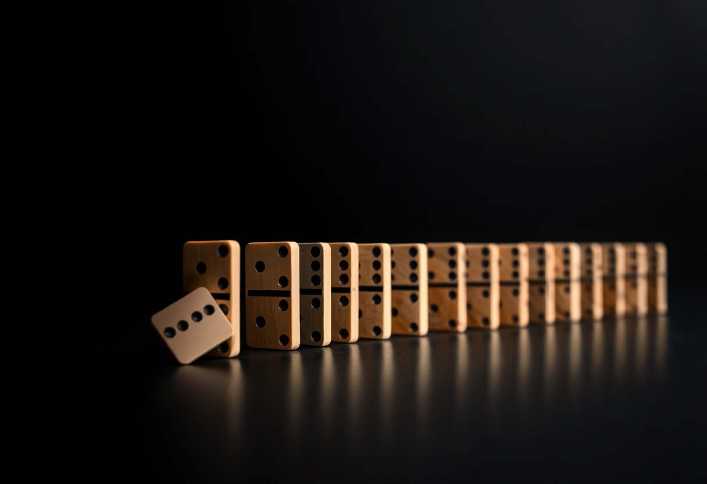
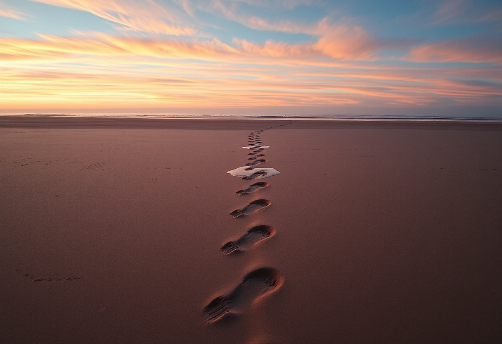
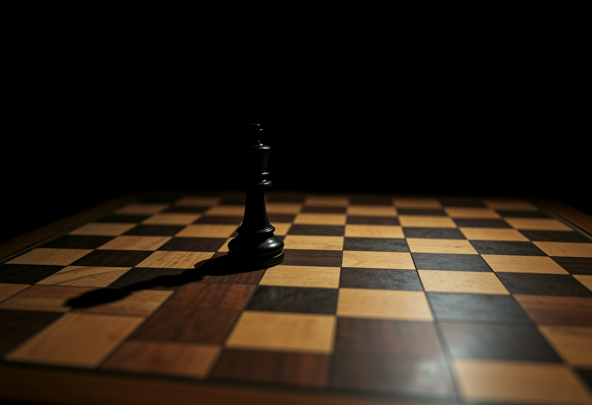

# Destin

Publication du 20 septembre 2026 — 3 photographies.

---

## 01 — La chute qui entraîne le reste

Un domino a déjà basculé. Il est encore en l'air, à mi-chemin de sa chute, alors que
tous les autres, derrière lui, se tiennent parfaitement droits — pour l'instant. Rien
dans leur alignement ne dit qu'ils vont tomber : ils sont juste posés là, dans le même
ordre depuis le début. Et pourtant, dès que le premier a basculé, la suite n'est plus
vraiment une question.

C'est une image assez juste du destin tel qu'on le ressent parfois : non pas une
volonté extérieure qui déciderait à notre place, mais une mécanique enclenchée par un
geste minuscule, souvent après coup — un mot dit plutôt qu'un autre, une porte prise
plutôt qu'une autre. Sur le moment, ce premier geste ne pèse rien. Ce n'est qu'en
regardant la chaîne entière, depuis la fin, qu'on peut dire : c'est là que tout a
commencé.

Ce que la photo garde en suspens, volontairement, c'est le milieu du mouvement — ni
le déclencheur, déjà passé, ni la chute finale, pas encore arrivée. Le destin ne se
voit presque jamais en train de se faire : on ne le reconnaît qu'une fois la rangée
entière tombée, en remontant du dernier domino jusqu'au premier.

Modèle de génération : ShowMe5WH — Flux.1 Schnell.

---

## 02 — La trace qu'on ne peut reprendre

Une seule ligne d'empreintes traverse une plage vide, du premier plan jusqu'à
l'horizon. Les plus proches, déjà, se remplissent d'eau et perdent leurs contours ;
celles du fond, plus loin dans le temps de la marche, restent nettes, intactes,
presque plus vraies que les récentes. Le sable ne garde pas tout au même rythme : ce
qui vient d'être fait s'efface le premier.

Le destin, souvent, se raconte à l'envers : on regarde le chemin parcouru et on y
voit une ligne cohérente, presque nécessaire, alors qu'au moment de chaque pas, rien
n'était certain — seulement le sable sous le pied suivant. Ce qui rend cette trace
irréversible, ce n'est pas qu'elle ait été voulue ainsi depuis le début : c'est
qu'une fois posée, aucun pas ne peut être repris sans en laisser un autre à côté.

Devant, le sable reste lisse, sans aucune marque. C'est peut-être la seule vraie
liberté que laisse un destin qu'on ne choisit pas entièrement : celle du pas
suivant, encore à faire, sur une surface qui n'a encore rien enregistré.

Modèle de génération : ShowMe5WH — Flux.1 Schnell.

---

## 03 — La pièce déjà avancée

Sur un échiquier par ailleurs entièrement vide, une seule pièce noire se tient déjà
au centre, loin de sa rangée de départ. Aucune main dans le cadre, aucun adversaire
visible, aucune autre pièce pour expliquer ce coup : on découvre la partie après le
premier mouvement, comme si elle avait commencé avant nous, ou sans nous.

C'est une sensation assez proche de ce qu'on appelle le destin : l'impression, à un
moment donné, que la partie est déjà engagée quand on y prête enfin attention — que
des choix ont eu lieu, quelque part, avant qu'on ait eu son mot à dire. L'ombre de la
pièce, démesurée par rapport à sa taille réelle, dit bien cela : une seule décision
peut s'étendre bien au-delà d'elle-même, occuper un espace que rien d'autre sur le
plateau ne vient encore contester.

Il reste malgré tout un échiquier vide autour de cette pièce, un espace de jeu
intact. Le destin, dans cette image, n'a pas encore rempli le plateau — il a
seulement fait le premier geste.

Modèle de génération : ShowMe5WH — Flux.1 Schnell.
