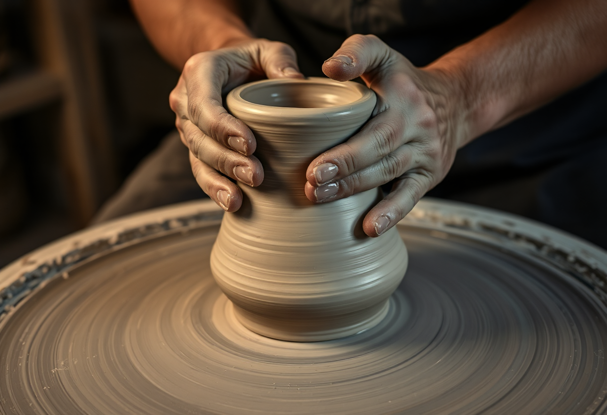
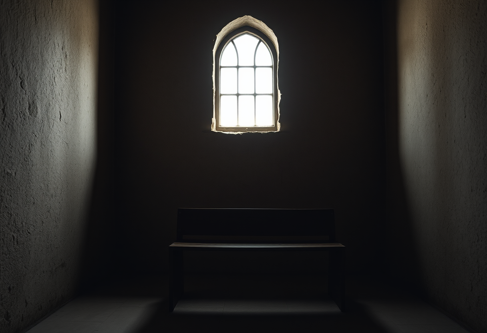
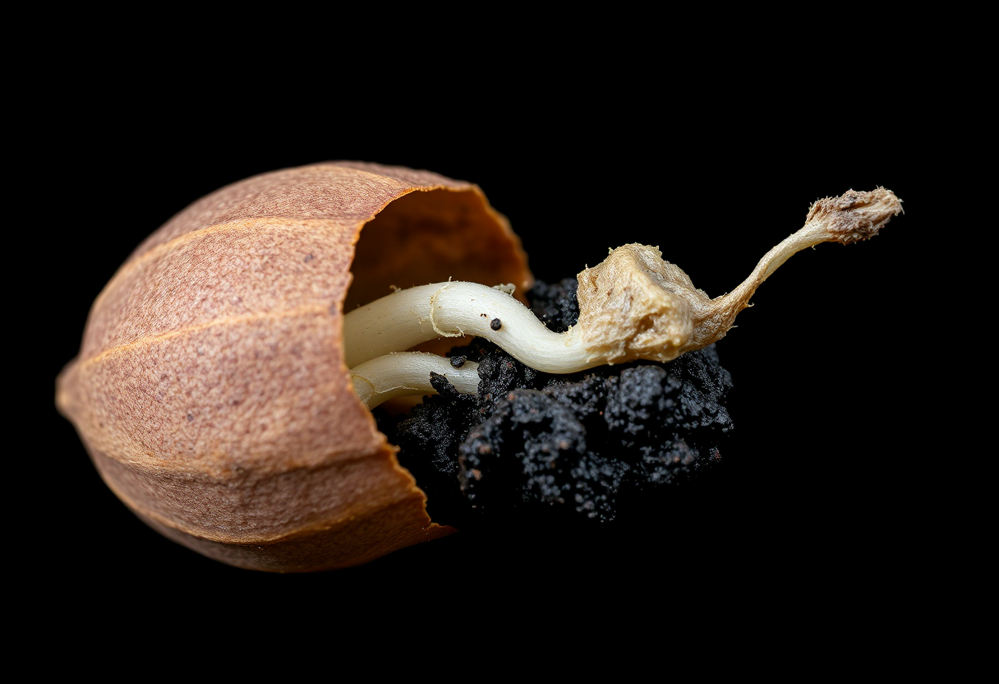

# Dieu

Publication du 27 septembre 2026 — 3 photographies.

---

## 01 — Les mains dans l'argile

Deux mains couvertes de terre pressent une masse d'argile encore grossière, à peine
sortie de sa forme informe. Le geste se répète, patient, presque mécanique : serrer,
lisser, remonter la matière vers un contour qui n'existe pas encore. Rien n'indique à
qui appartiennent ces mains — pas de visage, pas de regard, seulement le travail en
train de se faire.

C'est peut-être la plus ancienne image qu'on se soit faite du divin, bien avant les
récits qui lui donnent un nom : moins un "qui" tout-puissant qu'un "comment"
patient — une force qui prend de la matière brute et lui donne un contour. Les mythes
qui font naître l'humain de la glaise, façonné par des mains qui ne se montrent pas,
racontent moins une création soudaine qu'un geste d'artisan, recommencé jusqu'à ce que
la forme tienne.

Ce qui frappe, dans cette image, c'est l'absence justement de ce qu'on attend d'un
créateur : aucun visage, aucun regard qui validerait le résultat. Seulement des mains,
et de la matière qui cède lentement sous leur pression. Le divin, ici, ne se prouve
pas : il se devine à l'effet qu'il produit, jamais à la figure qui le porterait.

Modèle de génération : ShowMe5WH — Flux.1 Schnell.

---

## 02 — Le banc face au mur nu

Un seul banc de bois, usé par des générations d'usage, fait face à un mur de pierre
claire et parfaitement nu. Une lumière froide tombe d'une fenêtre haute, sur le côté,
sans jamais éclairer directement le mur qu'elle frôle. Aucune croix, aucune statue,
aucune image ne vient dire à qui ou à quoi s'adresse ce lieu. Il ne reste que
l'architecture, et le silence qu'elle organise.

Beaucoup de traditions se méfient de l'image du divin — non par manque d'imagination,
mais par discipline : donner un visage à ce qu'on ne peut pas voir, c'est déjà le
réduire à quelque chose de trop petit. Un mur nu, en ce sens, n'est pas un vide qu'on
n'a pas encore rempli : c'est un choix délibéré de laisser toute la place à ce qui ne
se représente pas.

Le banc, lui, ne regarde rien en particulier. Il attend simplement, tourné vers un mur
qui ne répondra jamais par une image. C'est peut-être à cela que ressemble une grande
partie de ce qu'on appelle la foi : non pas la certitude d'une présence qu'on pourrait
montrer du doigt, mais la discipline de rester assis, face à ce qui reste muet.

Modèle de génération : ShowMe5WH — Flux.1 Schnell.

---

## 03 — La graine qui se fend

Sur fond noir, une graine dont l'enveloppe brune vient de céder laisse sortir une
racine blanche, encore fragile, à peine plus épaisse qu'un fil. Un peu de terre sombre
et humide colle à l'enveloppe fendue. Rien ne pousse cette graine de l'extérieur :
elle se fend d'elle-même, au moment où elle se fend, sans qu'aucune main ni aucune
volonté visible n'intervienne dans le cadre.

Il existe une autre façon de penser le divin, moins tournée vers une volonté qui
déciderait depuis l'extérieur, plus proche d'une force qui traverse la matière
elle-même — celle qui fait qu'une graine, dans de bonnes conditions, ne peut pas ne
pas se fendre. Pas un geste ponctuel, mais un principe qui continue d'agir sans avoir
besoin d'être renouvelé à chaque fois.

Ce qui rend ce geste presque vertigineux, c'est son ordinaire : il a lieu des
milliards de fois, sans témoin, sans qu'on ait besoin d'y croire pour qu'il se
produise. Si le divin loge quelque part dans une graine qui se fend, ce n'est pas dans
la preuve qu'elle en donnerait, mais dans le fait qu'elle continue, obstinément, à ne
pas avoir besoin de preuve.

Modèle de génération : ShowMe5WH — Flux.1 Schnell.
