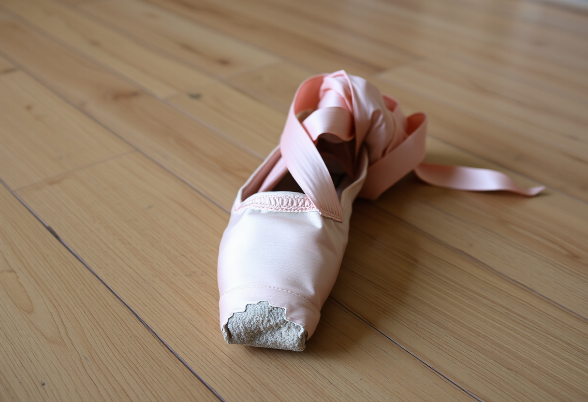
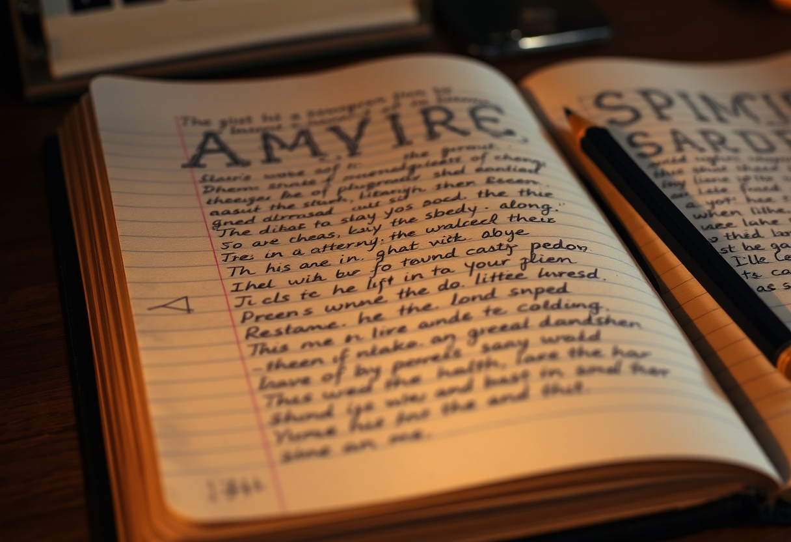

# Passion

Publication du 4 octobre 2026 — 3 photographies.

---

## 01 — Les doigts marqués

Sous une lampe d'atelier, une main presse des cordes de guitare jusqu'à en effacer les
contours de ses propres doigts. La peau du bout des doigts a durci par endroits, s'est
marquée de petites zones rougies là où la pression revient, soir après soir, toujours
au même endroit. Pas de visage dans le cadre, pas de public, pas d'instant de scène —
seulement ce contact répété entre une main et un fil tendu.

La passion ne s'annonce pas, elle s'imprime. Ce ne sont pas les mots qu'on emploie pour
la décrire qui la rendent réelle, mais ce qu'elle laisse derrière elle sur un corps qui
a continué sans qu'on le lui demande : un cal, une callosité, une sensibilité qui
s'émousse à force d'insister au même endroit. On ne choisit pas d'avoir ces
marques-là ; on choisit seulement de revenir, encore, presser encore la corde qui a
déjà fait mal hier.

Ce que personne ne voit dans ces doigts, c'est le nombre de fois où le geste a été
refait avant de devenir indolore. La passion, ici, n'est pas l'instant où l'on joue
bien : c'est tout ce temps, invisible et répétitif, qu'il a fallu pour que la main
cesse de se plaindre.

Modèle de génération : ShowMe5WH — Flux (schnell).

---

## 02 — Le chausson usé à la pointe

Posé seul sur un parquet rayé, un chausson de danse classique montre sa pointe trouée,
le satin rose parti en lambeaux là où tout le poids d'un corps est venu retomber,
encore et encore. Le ruban reste noué, prêt à être rechaussé, comme si la pause
n'était que momentanée. Aucune danseuse dans le cadre : seulement l'objet, et ce qu'il
garde en mémoire du nombre de fois où il a touché le sol.

Un chausson comme celui-ci ne ment pas sur l'intensité d'une pratique — il l'inscrit
directement dans sa matière, sans avoir besoin qu'on la raconte. La passion s'y mesure
moins en heures de répétition qu'en ce qu'elle use : un tissu qui cède avant le corps,
une pointe qui se troue avant que le geste ne soit parfait. C'est une forme d'endurance
qui ne cherche pas de témoin.

Ce qui frappe, dans cette usure précise, c'est qu'elle ne s'arrête jamais au bon
moment : on continue après que le chausson a commencé à céder, parce que s'arrêter
coûterait davantage que recoudre, retaper, repartir. Le chausson usé n'est pas l'échec
d'une pratique — il en est la preuve la plus honnête.

Modèle de génération : ShowMe5WH — Flux (schnell).

---

## 03 — Le carnet qui déborde

Sous une lumière tamisée, un carnet reste ouvert sur des pages gondolées par l'usage,
saturées d'une écriture serrée qui revient sans cesse sur elle-même — reprise,
raturée, redessinée dans la marge dès qu'une ligne ne convient pas. Un crayon usé
repose juste à côté, posé là comme s'il venait d'être reposé pour la centième fois,
pas pour la dernière. Personne n'a demandé que ce carnet soit rempli ainsi.

C'est peut-être la forme la plus silencieuse de la passion : non pas un geste
spectaculaire, mais l'incapacité à laisser une page telle qu'elle est. On revient sur
le même mot, la même phrase, parce qu'une version plus juste existe encore quelque
part et qu'on ne peut pas s'empêcher de la chercher. Le carnet ne déborde pas parce
qu'on l'a rempli une fois, mais parce qu'on y est revenu, inlassablement, bien après
que c'était nécessaire.

Ce qui distingue cette écriture d'une simple corvée, c'est l'absence totale
d'obligation : rien ne force à raturer une troisième fois ce qui était déjà lisible la
première. Seule la passion explique qu'on continue à chercher, dans la même page, une
forme qu'on n'a pas encore trouvée.

Modèle de génération : ShowMe5WH — Flux (schnell).
