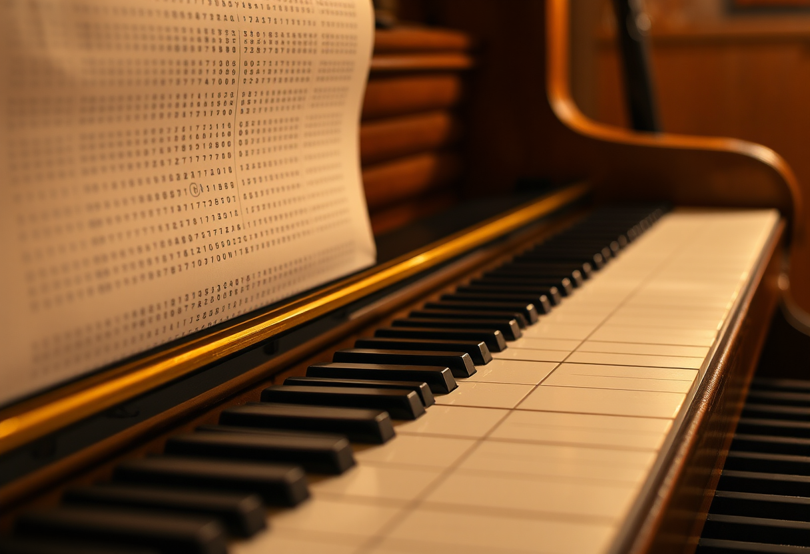

# Intelligence artificielle

Publication du 11 octobre 2026 — 3 photographies.

---

## 01 — La carte qui dicte un motif

Sous la lumière rasante d'un atelier, une carte perforée avance dans le mécanisme d'un
métier à tisser. Chaque trou, chaque plein, décide seul si un fil se lève ou reste en
place — rien d'autre. Au-dessus, les fils rouges et écrus commencent déjà à dessiner un
motif que personne, dans la pièce, ne regarde se former.

La carte ne sait pas ce qu'elle tisse. Elle ne voit pas le motif, n'anticipe pas la
prochaine rangée, ne corrige jamais une erreur qu'elle ne peut pas percevoir. Elle
exécute, trou après trou, une instruction écrite avant elle, par quelqu'un d'autre,
pour un résultat qu'elle ne connaîtra jamais. C'est pourtant de cette logique précise —
présence ou absence, haut ou bas, un ou zéro avant même que le mot n'existe — que
naîtront, plus tard, les premières machines à calculer, puis les premiers programmes.

Ce qu'on appelle aujourd'hui intelligence artificielle tient encore de ce principe : un
enchaînement d'instructions sans compréhension de ce qu'il produit, mais capable, à
force de répétitions et de règles, de faire apparaître quelque chose qui ressemble, de
loin, à une intention.

Modèle de génération : ShowMe5WH — Flux (schnell).

---

## 02 — Le rouleau qui joue seul

Dans la pénombre chaude d'un salon, un piano mécanique joue seul. Le rouleau de papier
défile devant le clavier, strié de rangées de chiffres et de symboles serrés — une
partition sans portée, sans clé, sans rien qui ressemble à de la musique pour qui ne
sait pas la lire. Les touches s'abaissent pourtant, l'une après l'autre, dans le bon
ordre, au bon tempo. Aucune main ne les touche.

Le rouleau ne connaît pas la mélodie qu'il produit. Il ne l'a jamais entendue, ne
saurait pas la reconnaître si elle jouait ailleurs, sur un autre instrument. Il contient
seulement une suite de repères, un à un, qu'un mécanisme traduit en pression sur une
touche, en vibration d'une corde. Le résultat sonne juste, émeut peut-être celui qui
l'écoute — sans qu'aucune émotion, nulle part dans le système, n'ait eu lieu.

C'est tout l'écart entre produire et comprendre : la machine peut recomposer une
musique entière sans jamais l'avoir ressentie une seule fois. Ce que l'intelligence
artificielle interroge aujourd'hui n'est pas si différent — un texte qui touche, une
image qui saisit, générés par un système qui n'a, lui, rien ressenti du tout.

Modèle de génération : ShowMe5WH — Flux (schnell).

---

## 03 — La ruche sans architecte

Dans l'obscurité d'une ruche, les alvéoles de cire prennent forme une à une. Aucune
abeille ne porte de plan, aucune ne dirige les autres ; chacune façonne sa cellule selon
quelques règles simples, répétées des milliers de fois par des milliers d'individus. Et
pourtant, de cette absence totale de supervision centrale, surgit la régularité presque
parfaite de l'hexagone — la forme la plus économe en cire pour la surface qu'elle
enferme.

Personne, dans la ruche, ne sait ce qu'est un hexagone. Aucune abeille n'a calculé
qu'il s'agissait de la solution optimale à un problème géométrique. L'ordre apparaît
quand même, non pas malgré l'absence d'une intelligence centrale, mais à cause d'elle :
des milliers d'unités simples, suivant chacune une règle locale, produisent ensemble une
structure qu'aucune d'elles, seule, n'aurait pu concevoir.

C'est l'une des images les plus fidèles qu'on puisse se faire d'un réseau de neurones
artificiels : pas un esprit unique qui réfléchit, mais une multitude de règles
élémentaires, appliquées en parallèle, dont l'enchaînement produit — sans qu'aucune
partie du système ne la comprenne — une forme d'ordre qui, de loin, ressemble à de
l'intelligence.

Modèle de génération : ShowMe5WH — Flux (schnell).
