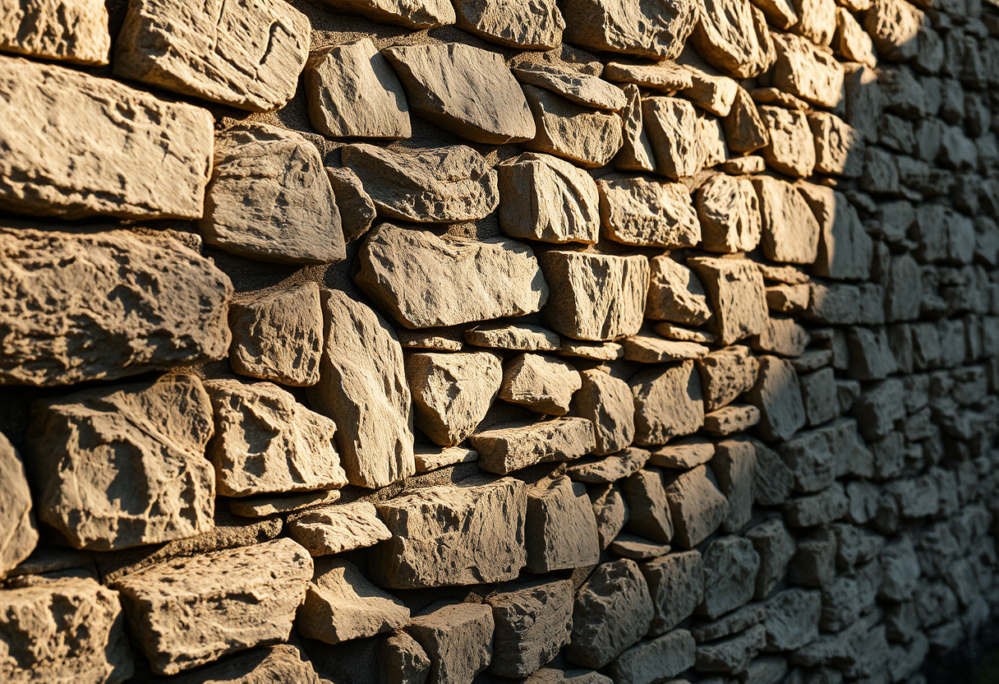

# Sagesse

Publication du 18 octobre 2026 — 3 photographies.

---

## 01 — Le mur qui tient sans rien forcer

Un mur de pierres sèches ne doit rien à la force : aucun mortier ne le fige, aucune
armature ne le redresse. Chaque pierre a été choisie pour sa forme propre, tournée,
calée, essayée à nouveau jusqu'à trouver l'appui qui ne bouge plus. Rien n'est ajouté
pour combler — on compose avec ce qu'on a sous la main, et ça tient, parfois depuis des
générations.

C'est une image de la sagesse qui doit peu aux images attendues — ni vieillard, ni
livre, ni chouette perchée. Elle n'est pas un savoir qu'on exhibe mais un geste
répété : regarder ce qui se présente, accepter sa forme irrégulière, l'ajuster sans le
forcer. Le mur ne proclame rien. Il tient, simplement, parce que chaque pierre a trouvé
sa juste place.

Modèle de génération : ShowMe5WH — Flux (schnell).

---

## 02 — Le nœud qui ne demande plus réflexion

Un marin ne pense plus son nœud, il le fait. Des années de vent, de corde mouillée et
de gestes recommencés ont fini par loger le savoir dans la main plutôt que dans la
tête — exactement assez de tours, pas un de plus, serré juste ce qu'il faut pour tenir
sans jamais se défaire sous la tension.

C'est une autre facette de la sagesse : non pas une idée qu'on détient, mais une
économie qu'on atteint à force de répétition. Le geste juste, débarrassé de tout
superflu, qui ne se remarque même plus à force d'être devenu évident. Rien
d'ostentatoire dans cette corde usée par le sel — seulement l'exactitude tranquille de
ce qui a été fait, défait et refait, jusqu'à ne plus pouvoir être fait autrement.

Modèle de génération : ShowMe5WH — Flux (schnell).

---

## 03 — La tasse qu'on laisse encore infuser

La fumée monte, le thé est prêt — et pourtant la tasse attend, intacte, un instant de
plus sur la table. Rien n'oblige à la porter tout de suite aux lèvres. Ce délai, à peine
perceptible, est peut-être la forme la plus discrète de la sagesse : savoir que tout
n'a pas besoin d'être consommé à l'instant où il devient possible.

Pas de vieux sage, pas de balance, pas de symbole appuyé — juste une pièce ordinaire,
une lumière de fin d'après-midi, et ce court refus de se précipiter. La sagesse, ici,
n'est pas de savoir quoi faire. C'est de savoir attendre encore un peu avant de le
faire.

Modèle de génération : ShowMe5WH — Flux (schnell).
