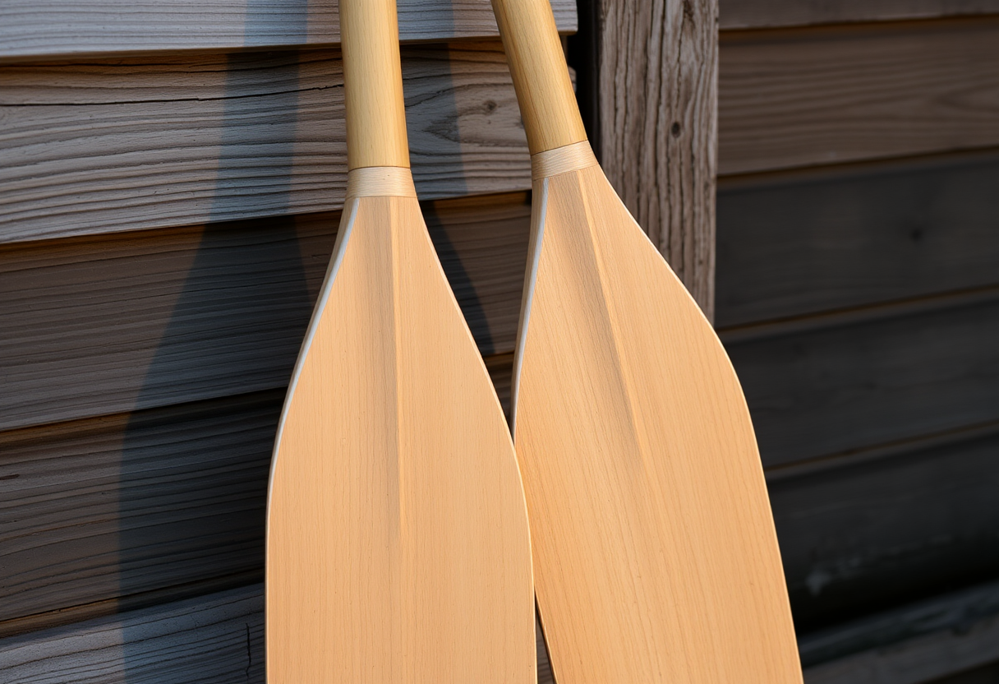

# Discipline

Publication du 25 octobre 2026 — 3 photographies.

---

## 01 — Le manche que la main retrouve chaque matin

Deux rames appuyées contre le mur d'un hangar à bateaux, au lever du jour. Leurs
manches ne sont pas neufs : ils sont polis, pâlis, usés exactement là où la main
revient, saison après saison, toujours au même endroit sur le bois. Les pales
sont encore mouillées — la sortie de l'aube vient de s'achever, une de plus dans
une série qui ne compte plus ses répétitions.

La discipline n'est pas un sursaut de volonté ni un exploit ponctuel : c'est ce
polissage lent, invisible tant qu'on le regarde une seule fois, qui ne devient
visible qu'additionné sur des années. Personne ne décide, un matin donné,
d'user ainsi le bois. Cela arrive seulement parce que la main revient, encore,
avant que le jour ne soit levé.

Modèle de génération : ShowMe5WH — Flux (schnell).

---

## 02 — Le clou, toujours le même

Un vestiaire vide, une lumière basse de fin d'après-midi. La corde à sauter
n'est pas jetée dans un coin après l'effort : elle est enroulée avec soin et
suspendue au même clou que la veille, et que le jour d'avant. L'entraînement
lui-même ne se voit pas sur cette photo — seul reste ce geste minuscule qui le
referme.

C'est peut-être la part la moins montrée de la discipline : non pas l'effort,
qui a des témoins, mais ce qui se passe une fois qu'il n'y en a plus. Ranger
l'instrument exactement comme il a toujours été rangé, sans que personne ne le
vérifie, sans que cela change jamais rien à la séance déjà terminée — seulement
parce que c'est ainsi que les choses se font, ici, tout le temps.

Modèle de génération : ShowMe5WH — Flux (schnell).

---

## 03 — Le pli qui ne varie pas

Un tiroir ouvert, une pile de chemises repassées. Rien ne distingue le pli du
dessus de celui, invisible, tout en bas de la pile — chacun aligné sur le
précédent avec la même précision, comme si une règle avait servi à chaque
fois, alors qu'il n'y a jamais eu que des mains et une habitude.

C'est une discipline sans spectateur ni enjeu apparent : personne ne félicite
un pli bien fait, personne ne remarque un tiroir rangé. Elle tient tout
entière dans la constance d'un geste domestique que rien n'oblige à répéter à
l'identique — sinon la décision, prise une fois, de ne jamais le laisser
varier.

Modèle de génération : ShowMe5WH — Flux (schnell).
