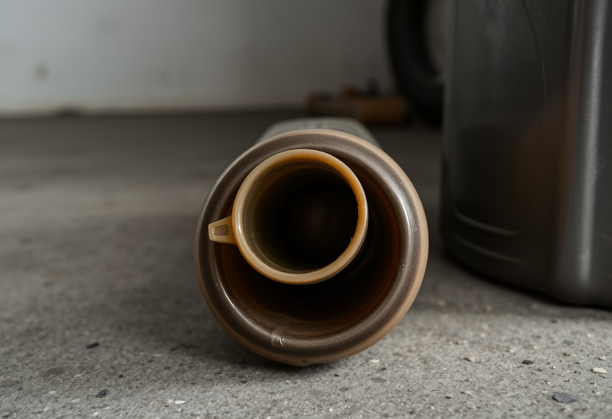

# Ingéniosité

Publication du 1er novembre 2026 — 3 photographies.

---

## 01 — Le cintre qui capte mieux que l'antenne d'origine

Un vieux poste de radio sur une étagère d'atelier, encombrée d'outils et de
boîtiers empilés. L'antenne d'origine a dû casser ou se perdre un jour — à sa
place, un cintre métallique redressé, plié en triangle, scotché au dos du
poste avec deux bouts de ruban adhésif. Rien d'élégant, mais le geste a réglé
le problème sans attendre une pièce de rechange.

L'ingéniosité tient rarement dans l'invention d'un objet nouveau : elle tient
dans ce détournement minute, presque honteux de sa propre simplicité, qui
refuse qu'un problème reste sans solution faute du bon matériau sous la main.
Personne ne regarde ce cintre deux fois — il fait son travail, et c'est
exactement tout ce qu'on lui demande.

Modèle de génération : ShowMe5WH — Flux (schnell).

---

## 02 — Le goulot qui n'a jamais été conçu pour ça

Au ras du sol en béton d'un garage, un bidon d'huile de moteur attend, son
goulot évasé en embout improvisé : la partie supérieure d'un emballage
plastique récupéré, enfoncée là où devrait se trouver un entonnoir acheté
pour l'usage. L'ajustement n'est pas parfait, mais il canalise, et c'est tout
ce qu'on lui demande avant de reboucher et de ranger.

Ce genre de solution ne cherche jamais l'approbation de personne : elle existe
seulement parce qu'un soir, verser sans entonnoir faisait courir le risque
d'en renverser partout, et qu'un bout de plastique qui traînait avait
justement la bonne forme. L'ingéniosité domestique se reconnaît à ça — elle
ne prévoit rien, elle répond.

Modèle de génération : ShowMe5WH — Flux (schnell).

---

## 03 — Le nœud qui remplace la boucle cassée

Une sangle de sac à dos, suspendue contre une porte en bois usée par les
saisons. Là où une boucle en plastique s'est cassée, un nœud serré, tressé à
la main avec une cordelette, referme la sangle sur elle-même et tient le sac
tout aussi bien — peut-être mieux, puisqu'un nœud ne se fissure pas d'un coup
sec par temps froid.

Il y a une forme de confiance particulière à faire reposer le poids de ses
affaires sur un geste qu'on a fait soi-même plutôt que sur une pièce
fabriquée en usine. Ce nœud ne cherche pas à imiter la boucle qu'il remplace :
il résout le même problème autrement, avec ce qu'il y avait sous la main,
et sans attendre qu'on en rachète une.

Modèle de génération : ShowMe5WH — Flux (schnell).
