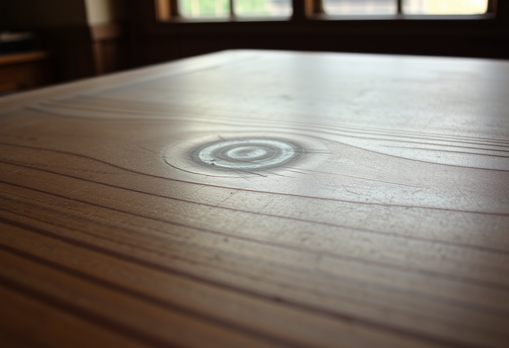
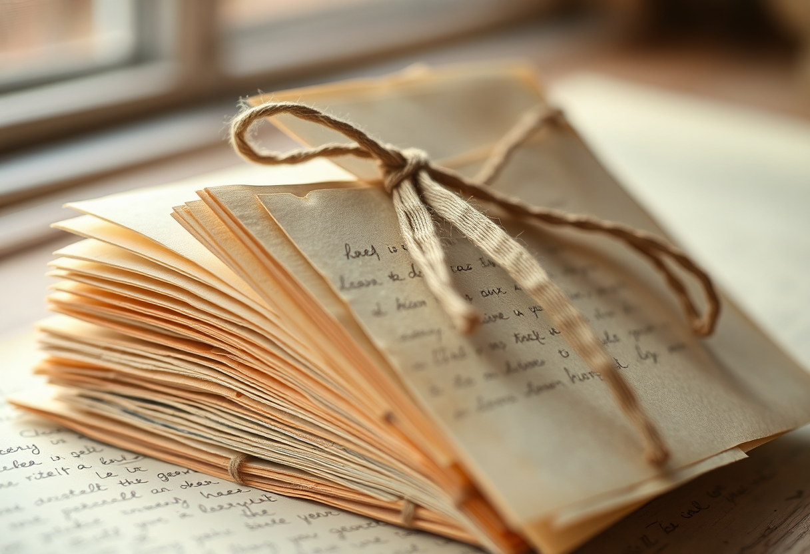

# Humanisme

Publication du 8 novembre 2026 — 3 photographies.

---

## 01 — Le creux que des générations de coudes ont poli

Un pupitre d'école en bois, usé en son centre jusqu'à devenir presque lisse,
presque clair, là où des générations d'avant-bras et de coudes se sont
appuyés pendant qu'on apprenait à lire, à compter, à douter. Sur le bord, une
marque gravée au canif, trace discrète d'une main qui voulait laisser
quelque chose derrière elle.

L'humanisme, avant d'être une doctrine, est un pari sur l'instruction : l'idée
qu'on devient pleinement soi-même en apprenant, et que ce savoir ne vaut que
transmis. Chaque usure de ce bois est la preuve silencieuse qu'une personne
en a formé une autre, puis une autre encore — le même geste répété,
jamais identique, jamais inutile.

Modèle de génération : ShowMe5WH — Flux (schnell).

---

## 02 — L'embout usé par des milliers de battements écoutés

Un stéthoscope posé sur une table en bois sombre, les embouts noircis et
assouplis par des années d'usage, le pavillon de métal légèrement terni par
les mains qui l'ont tenu. Un objet sans prétention, pensé pour une seule
chose : entendre ce qui se passe à l'intérieur d'un corps qu'on ne connaît
pas encore.

L'humanisme place la personne — sa douleur, sa vie, sa dignité — avant toute
abstraction qui voudrait la réduire à un cas ou un numéro. Cet instrument ne
soigne rien par lui-même ; il sert seulement à écouter, le premier geste
avant tous les autres, celui qui reconnaît qu'en face il y a quelqu'un.

Modèle de génération : ShowMe5WH — Flux (schnell).

---

## 03 — Une liasse de lettres qu'on n'a pas pu jeter

Une petite liasse de lettres manuscrites, nouée d'un ruban fatigué, le papier
jauni aux bords et l'encre un peu passée. On ne lit presque rien du texte —
seulement la certitude qu'une main a tenu un stylo pour s'adresser à une
autre, avec le temps et la distance entre les deux.

Les humanistes de la Renaissance se sont d'abord reconnus par leurs lettres :
Érasme, Pétrarque et tant d'autres ont fait circuler leurs idées de main en
main, convaincus qu'une pensée ne vaut que partagée. Cette liasse continue le
même geste à son échelle — modeste, privée, mais portée par la même
conviction qu'une parole adressée à quelqu'un mérite d'être gardée.

Modèle de génération : ShowMe5WH — Flux (schnell).
