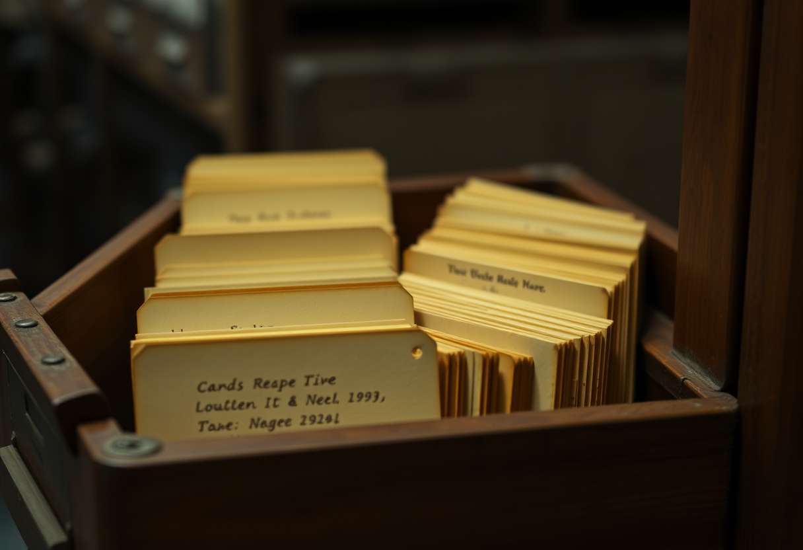

# Eugénisme

Publication du 15 novembre 2026 — 3 photographies.

Angle retenu : critique et mémoriel. L'eugénisme a été une doctrine
pseudo-scientifique qui a justifié des stérilisations forcées, des
classements administratifs et des concours publics de « familles aptes » —
jamais un idéal à illustrer. Les trois photos montrent des objets abandonnés,
sans aucune personne mise en scène, pour pointer vers cette histoire sans
jamais l'esthétiser.

---

## 01 — Le compas qui prétendait mesurer l'âme

Entre la fin du XIXe siècle et les années 1930, des médecins et des
anthropologues ont cru qu'un compas pouvait dire qui méritait de se
reproduire. Le crâne se mesurait au millimètre, l'écart entre les yeux se
notait sur une fiche, et ces chiffres servaient de preuve « scientifique » à
des lois de stérilisation forcée — aux États-Unis dès 1907, en Scandinavie
jusque dans les années 1970, puis, portée à une échelle industrielle, dans le
programme eugéniste du Troisième Reich (plus de 400 000 stérilisations entre
1933 et 1945, prélude direct à l'extermination des personnes handicapées dans
le programme Aktion T4).

Cette photo ne montre personne : un compas anthropométrique rouillé, abandonné
sur une table de bois dans un bureau vide. L'instrument a survécu à la
doctrine qui le justifiait. Il ne mesure plus rien — il rappelle seulement
qu'on a un jour fait semblant que le mètre pouvait trancher qui avait le droit
d'exister.

Modèle de génération : ShowMe5WH — Flux (schnell).

---

## 02 — Le tiroir à fiches

L'eugénisme n'a pas seulement produit des lois : il a produit de la
paperasse. Le *Eugenics Record Office* de Cold Spring Harbor, aux États-Unis,
a constitué pendant des décennies des dizaines de milliers de fiches
généalogiques classant des familles entières comme « aptes » ou « inaptes » à
se reproduire — alcoolisme, pauvreté, handicap et délit étaient notés sur la
même fiche que l'hérédité, sans distinction. Ces dossiers ont ensuite servi de
pièces à conviction devant les tribunaux américains pour justifier des
stérilisations forcées, validées par la Cour suprême elle-même en 1927.

La photo montre un tiroir de classeur ouvert, des fiches jaunies tassées les
unes contre les autres, aucun visage, aucun nom lisible. C'est précisément ce
que faisait cette administration : réduire une personne à une ligne dans un
tiroir, avant de décider à sa place de son droit à avoir des enfants.

Modèle de génération : ShowMe5WH — Flux (schnell).

---

## 03 — Le ruban bleu

Dans les années 1920, les foires agricoles américaines organisaient des
concours de « familles les plus aptes » (*Fitter Family Contests*) : entre le
concours de bétail et celui de confitures, des familles entières se
faisaient examiner par des médecins, mesurer, noter sur une fiche médicale,
pour repartir — ou non — avec un ruban bleu, la même récompense que la plus
belle vache de l'exposition. L'eugénisme n'était alors pas une doctrine
savante confinée aux laboratoires : c'était un divertissement populaire,
financé par des fondations respectées, qui apprenait à un public de fête
foraine à classer les êtres humains comme du bétail.

La photo montre ce ruban bleu suspendu à côté d'une toise murale, dans un
hangar de foire vide. Personne à mesurer, personne pour recevoir le prix —
seulement l'objet qui a validé, en souriant, l'idée qu'une vie humaine se note
comme une bête de concours.

Modèle de génération : ShowMe5WH — Flux (schnell).
