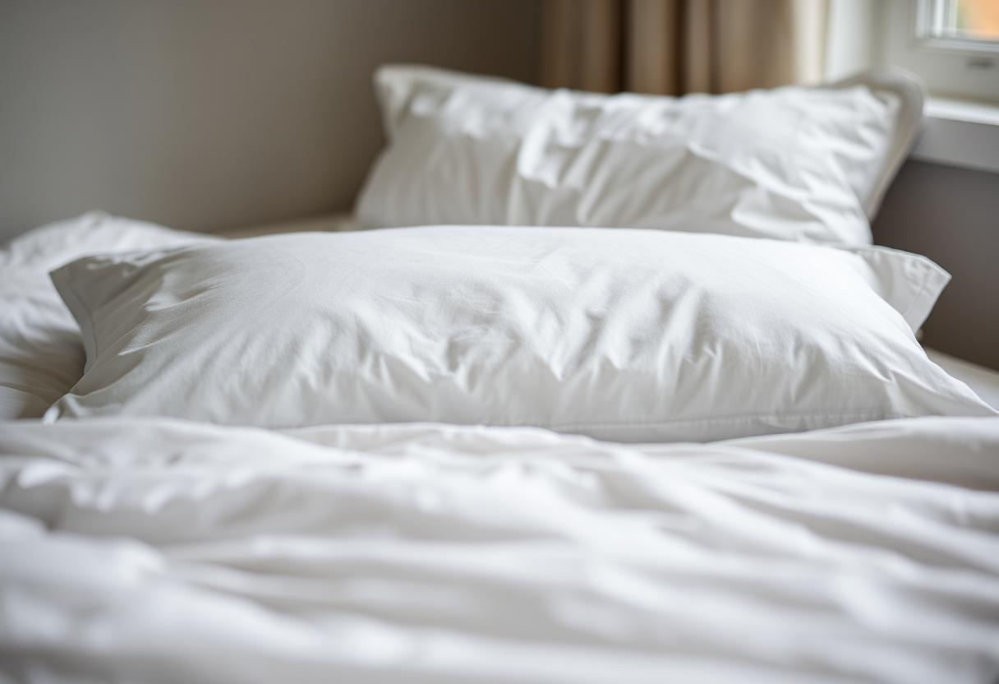
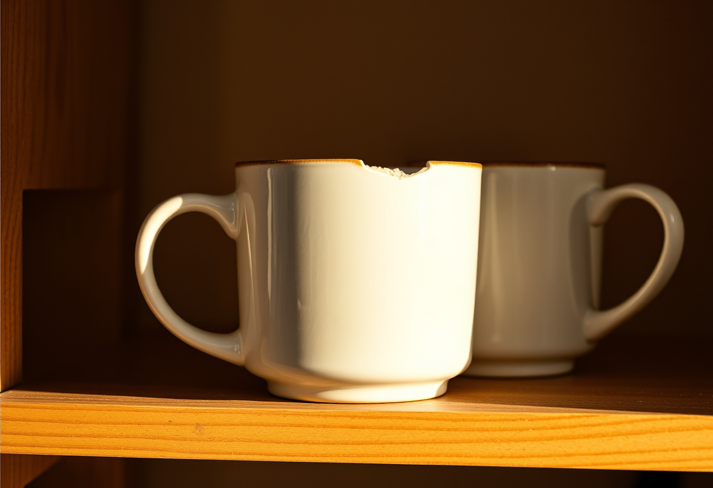
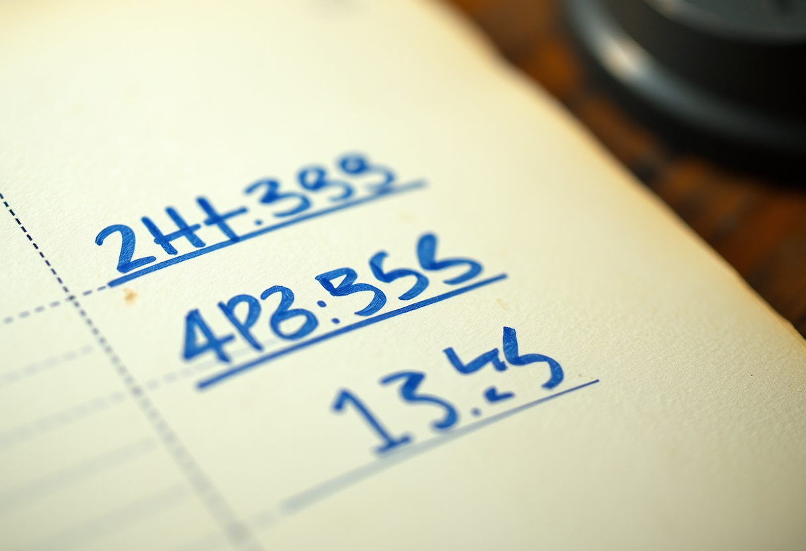

# Amour

Preview brute (image + texte, sans mise en page) — publication du 2026-11-22.

---

## Deux oreillers, pressés l'un contre l'autre

Un lit fait avec soin, tôt le matin. Rien d'autre à voir qu'un drap tiré et deux
oreillers posés côte à côte, légèrement enfoncés l'un dans l'autre — la trace
qu'ils gardent toutes les nuits sans qu'on y pense.

L'amour ne se photographie pas souvent dans ce qu'il a de plus discret : une
habitude muette, répétée chaque soir depuis des années, qui n'a besoin ni de
mot ni de regard pour exister. Ce lit ne dit rien d'un couple — on pourrait y
voir deux amis, une fratrie, une vieille habitude de n'importe quelle nature —
mais il dit quelque chose de l'amour comme partage d'un espace, nuit après
nuit, jusqu'à ce que les objets eux-mêmes en gardent la forme.

Modèle de génération : Flux (version schnell), via ShowMe5WH.

---

## La tasse ébréchée qu'on n'a pas jetée

Deux tasses identiques sur une étagère en bois, dans la lumière rasante de fin
d'après-midi. L'une porte un éclat net sur le bord — elle aurait dû finir à la
poubelle depuis longtemps. Elle est pourtant toujours là, propre, visiblement
encore utilisée, juste à côté de sa jumelle intacte.

On remplace facilement un objet neuf. Garder celui qui est abîmé, continuer à
s'en servir malgré l'ébréchure qui accroche parfois la lèvre, c'est un choix
plus silencieux — celui de préférer l'objet qu'on connaît, avec son défaut
familier, à un autre qui serait simplement parfait. L'amour tient aussi de
cette fidélité-là : moins le grand geste que la petite décision, répétée sans y
penser, de ne pas remplacer ce qui a déjà une histoire.

Modèle de génération : Flux (version schnell), via ShowMe5WH.

---

## Le même numéro, réécrit chaque année

Une page de vieux carnet d'adresses, sous la lumière chaude d'une lampe de
bureau. Un même numéro, griffonné à l'encre bleue, repassé plusieurs fois au
même endroit au fil des années — les couches se superposent, les traits
s'épaississent, l'écriture devient presque illisible à force d'avoir été
reprise.

Personne ne réécrit un numéro qu'on a oublié : on le réécrit parce qu'on
continue d'appeler, année après année, la même personne. Ce geste minuscule et
répété — composer encore ce numéro, le noter à nouveau quand l'encre pâlit —
est une des formes les plus têtues de l'amour : non pas une déclaration unique,
mais un contact qu'on refuse de laisser s'effacer.

Modèle de génération : Flux (version schnell), via ShowMe5WH.
